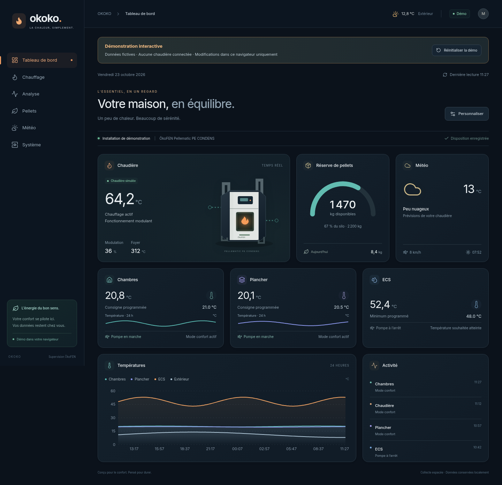
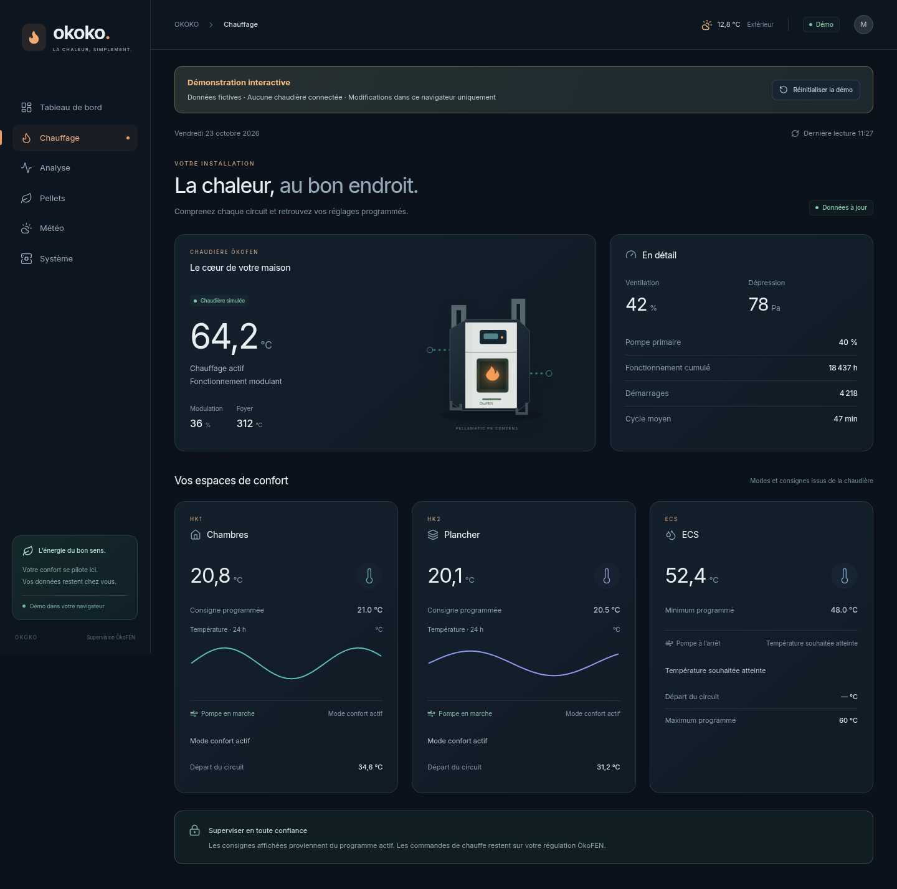
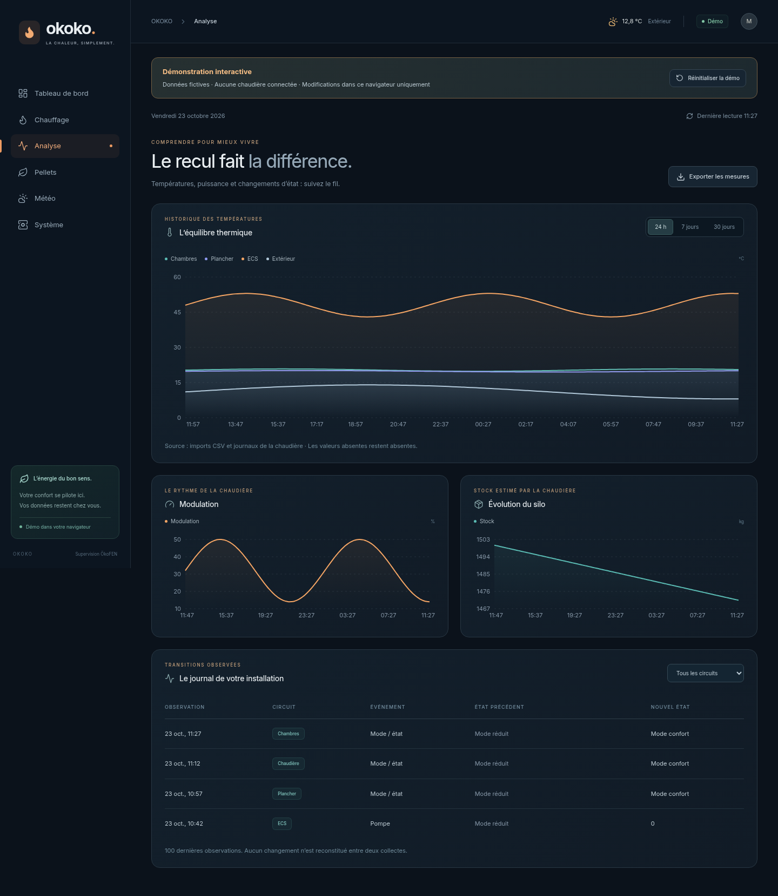
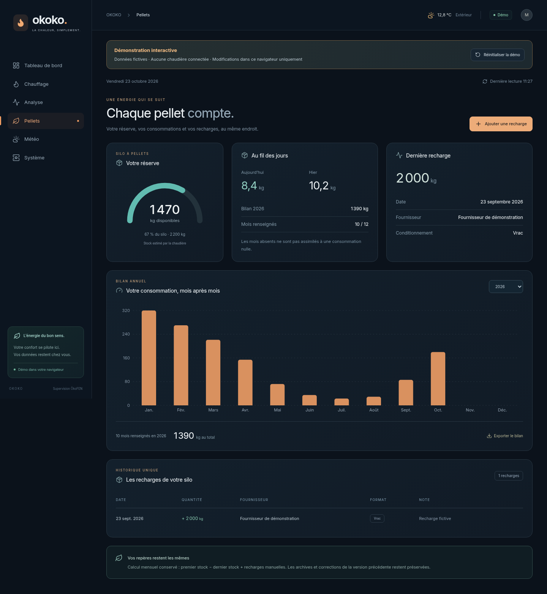
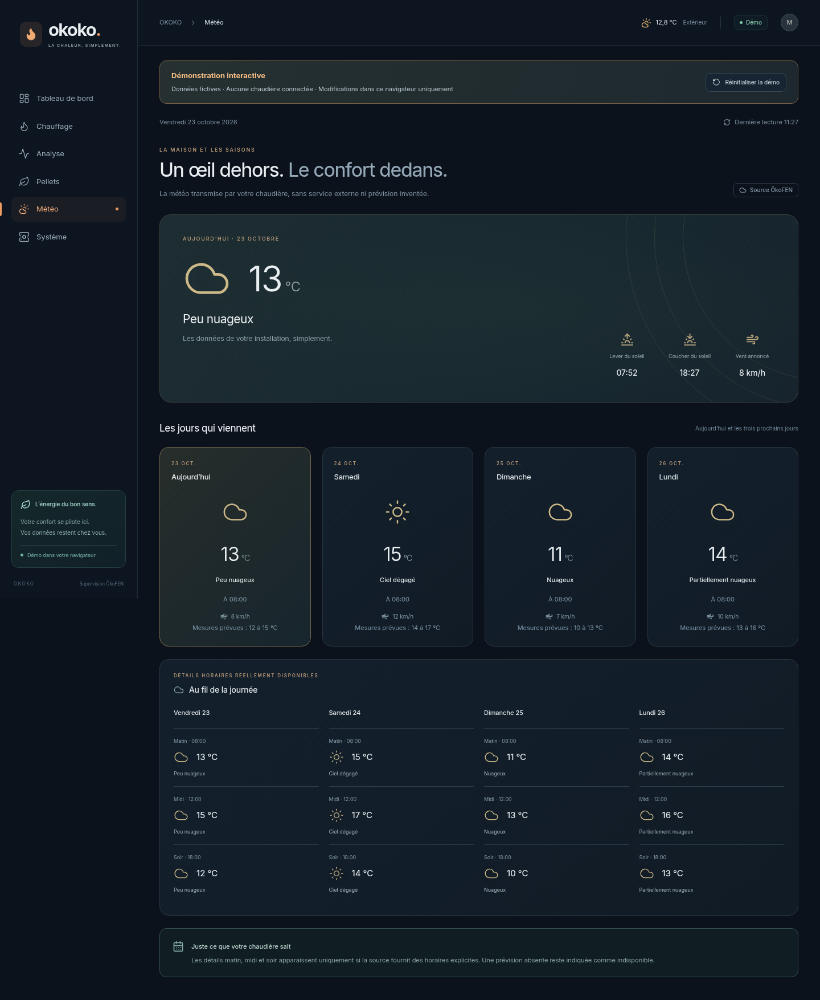
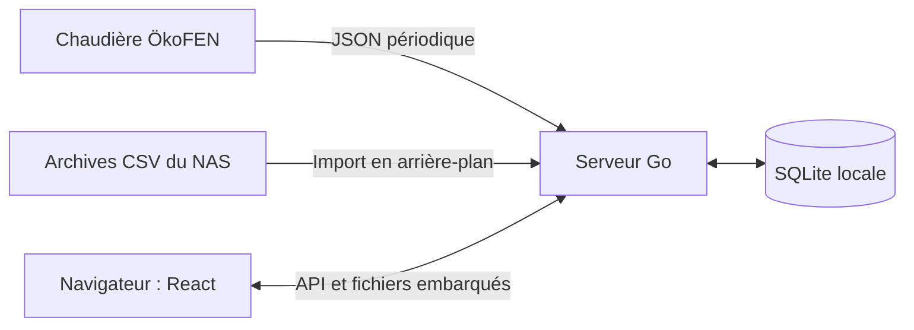

<div align="center">

# okoko.

**La chaleur, simplement.**

Supervision locale d’une chaudière **ÖkoFEN Pellematic > V4**.<br>
Un tableau de bord personnalisable, des historiques lisibles et des données qui restent chez vous.

[](https://github.com/sfley/okoko-v3/actions/workflows/project.yml)
[](backend/go.mod)
[](frontend/package.json)
[](docs/ARCHITECTURE.md)
[](LICENSE)

### [Essayer la démo →](https://sfley.github.io/okoko-v3/) · [Télécharger →](https://github.com/sfley/okoko-v3/releases/latest) · [Installer →](docs/INSTALLATION.md)

La démo est interactive et utilise des **données fictives**, sans connexion à une chaudière.<br>
Vous pouvez déplacer les widgets et essayer une recharge : tout reste dans votre navigateur.



</div>

## Votre installation, en un regard

Un thème bleu nuit, des accents orange et turquoise, des icônes SVG et une typographie embarquée. Une seule navigation, adaptée à l’ordinateur, à la tablette et au téléphone.

| Page | Ce que vous y trouvez |
|---|---|
| **Tableau de bord** | Cockpit : ajouter, retirer, déplacer et redimensionner les modules. Disposition enregistrée automatiquement par navigateur. |
| **Chauffage** | Chaudière, circuits HK1/HK2 nommés, eau chaude, consignes programmées, pompes et mini-courbes sur 24 heures. |
| **Analyse** | Historiques interactifs, température extérieure, modulation, sélection des courbes et transitions observées. |
| **Pellets** | Stock, consommations, recharges et bilan mensuel/annuel dans un historique unique. |
| **Météo** | Aujourd’hui et les trois jours suivants, à partir du JSON ÖkoFEN. Créneaux horaires uniquement lorsqu’ils sont fournis. |
| **Système** | Collecte, SQLite, NAS facultatif, sauvegarde et journal JSON/CSV paginé par dix lignes. |

Les modes et consignes sont consultables. Le changement des réglages reste sur la régulation ÖkoFEN : OKOKO ne transmet pas de commande de chauffage.

## Quelques vues

Captures prises dans Chromium sur l’application de démonstration, sans retouche ni données privées.

| Chauffage | Analyse |
|---|---|
| [](docs/screenshots/desktop-chauffage.png) | [](docs/screenshots/desktop-analyse.png) |
| **Pellets** | **Météo** |
| [](docs/screenshots/desktop-pellets.png) | [](docs/screenshots/desktop-meteo.png) |

<details>
<summary>Voir aussi Système, tablette et mobile</summary>

[État du système](docs/screenshots/desktop-systeme.png) · [Cockpit sur tablette](docs/screenshots/tablet-cockpit.png) · [Cockpit mobile](docs/screenshots/mobile-cockpit.png) · [Chauffage mobile](docs/screenshots/mobile-chauffage.png)

</details>

## Installer chez vous

Téléchargez **`okoko30-pro.zip`** dans la [dernière version](https://github.com/sfley/okoko-v3/releases/latest), puis extrayez l’archive dans un nouveau dossier.

Sous Windows, un seul lanceur enchaîne les étapes :

```powershell
.\INSTALLER-OKOKO.cmd
```

Il vérifie les outils, débloque les fichiers, teste, compile et propose le déploiement SSH vers le routeur. Une adresse vide prépare seulement les binaires. Il respecte `RemoteSigned`, s’arrête à la première erreur, garde sa fenêtre ouverte et reprend les étapes déjà réussies lorsque leurs sources et résultats sont inchangés.

L’ordinateur de compilation a besoin de **Go ≥ 1.24, Node.js 20.19+ dans la branche 20 ou ≥ 22.12, npm** et, pour le déploiement, d’OpenSSH. **Le routeur utilise seulement le binaire Go ARM64** : aucun Node.js ni serveur frontend à installer.

[Guide complet d’installation, configuration privée et retour arrière](docs/INSTALLATION.md) · [Détails du lanceur Windows](docs/LANCEUR-WINDOWS.md)

## Technologies et organisation

| Couche | Technologies |
|---|---|
| Interface | React 18, Vite 7, composants réutilisables |
| Cockpit et graphiques | React Grid Layout, Recharts |
| Identité visuelle | Lucide SVG, police Inter locale, CSS responsive |
| Serveur | Go, `net/http`, fichiers statiques embarqués avec `embed` |
| Données | SQLite via modernc.org/sqlite, collecte JSON ÖkoFEN, import CSV NAS |
| Validation et publication | Go tests, Node test runner, Playwright/Chromium, GitHub Actions et Pages |



```text
frontend/       Interface React, composants, styles et tests navigateur
  demo/         Données fictives et adaptateur de la démo publique
backend/        API Go, SQLite, collecte et imports
scripts/        Installation, tests, compilation, packaging et déploiement
.github/        Vérifications, publication Pages et versions téléchargeables
docs/           Installation, architecture, validation et captures
```

## Essayer ou développer

Pour lancer uniquement la démo, sans Go ni configuration de chaudière :

```sh
npm ci
npm run demo
```

Ouvrez l’adresse indiquée par Vite. Autre possibilité : [ouvrir le projet dans StackBlitz](https://stackblitz.com/github/sfley/okoko-v3?file=README.md).

Pour l’application locale complète :

```sh
npm ci --prefix frontend
npm run build --prefix frontend
mkdir -p backend/data
cd backend
go run ./cmd/chaudiere -config config.example.json
```

Ouvrez **http://127.0.0.1:8888**. L’exemple laisse la chaudière non configurée : aucune télémétrie n’est fabriquée. Les références historiques héritées de la version 2 restent présentes dans le moteur ; ne les confondez pas avec des relevés de votre propre installation.

Pour développer l’interface avec rechargement à chaud, laissez Go actif et lancez `npm run dev --prefix frontend` dans un autre terminal. Vite relaie les API vers le serveur local.

## Données, confidentialité et fiabilité

- La configuration d’exemple ne contient **aucun mot de passe ni URL privée**. Utilisez un fichier privé extérieur au dépôt avec `OKOKO_BOILER_URL_FILE`. Les configurations locales et bases SQLite sont exclues de Git.
- Les calculs de consommation hérités sont conservés ; les recharges et corrections existantes restent en SQLite. Le déploiement sauvegarde le binaire précédent et la base pour permettre un retour arrière.
- Un NAS indisponible n’empêche pas la consultation de l’application. Le frontend lit le cache du serveur et ne sollicite pas directement la chaudière.
- L’application réelle n’invente ni mesure ni prévision. Les valeurs absentes restent indiquées comme absentes. Les données fictives de la démo sont exclues de la compilation de production.
- L’interface locale est destinée au réseau domestique de confiance, sans authentification intégrée. Pour un accès distant, utilisez votre VPN ; seule la démo statique est destinée à être publique.

## Tests et limites

Les vérifications automatisées couvrent Go, les formats météo, la démo statique sous `/okoko-v3/`, les six pages à trois tailles d’écran, le cockpit, les recharges, les exports et la compilation Linux ARM64.

Le [rapport de validation](docs/TESTS.md) distingue les contrôles réellement exécutés des limites matérielles. Les essais cloud ne remplacent pas un démarrage sur le routeur, une console Windows réelle ou une connexion à votre chaudière.

[Contribuer](CONTRIBUTING.md) · [Signaler un problème](https://github.com/sfley/okoko-v3/issues) · [Architecture et API](docs/ARCHITECTURE.md)

## Faire découvrir OKOKO

Vous utilisez une chaudière ÖkoFEN et souhaitez partager le projet ? Le [kit de présentation](docs/COMMUNAUTE.md) propose un message pour les forums, une version courte et des communautés à explorer. Partagez la [démo publique](https://sfley.github.io/okoko-v3/), qui ne donne accès à aucune installation réelle. Les retours d’utilisateurs sont les bienvenus dans les [issues GitHub](https://github.com/sfley/okoko-v3/issues).

## Licence et origine

**[Licence MIT](LICENSE)** — © 2026 sfley et contributeurs. Refonte de la version Go/SQLite fournie d’OKOKO, avec conservation du moteur et des données historiques. Le [dépôt précédent](https://github.com/sfley/okoko-project/tree/okoko-v3.0) reste séparé pour conserver son historique.

Projet indépendant, sans affiliation avec ÖkoFEN. ÖkoFEN et Pellematic sont des marques de leurs détenteurs respectifs. Voir les [licences des dépendances](docs/THIRD-PARTY-LICENSES.txt).
